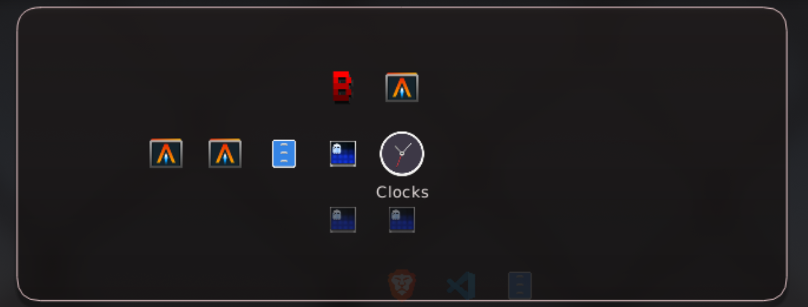

# niri-xmb

Workspace navigator and bar integration for [Niri](https://github.com/YaLTeR/niri).



Features:

- workspace and window navigation
- drag and drop between workspaces and columns
- per-output workspace bars
- cursor-positioned workspace navigator
- passive workspace peek
- themes and window urgency
- optional evdev gamepad buttons for the manual popup
- Noctalia taskbar integration
- persistent daemon for fast panel startup

Popup movement is off by default. Enable `behavior.move_popup` to press and
hold the configured border region, then move the pointer after the normal
`behavior.drag_threshold`. The offset lasts for the current session only;
`peek.move_popup` is a separate opt-in for an armed peek overlay.

Gamepad input is off by default. The `[gamepad]` table selects a built-in
`xbox` or `ds4` preset (or `auto` detection) and maps evdev button names or
16-bit codes to manual-popup actions. Explicit bindings override the preset.
Flydigi VADER4 and other xpad-compatible pads auto-detect as `xbox`, and
D-pad hat axes work even when the kernel sends no `BTN_DPAD_*` events.

The controller starts in **game** mode: niri-xmb does not grab it, so games get
normal input. `gamepad.mode.toggle` (default `BTN_MODE` + `BTN_START`) switches
to **navi** mode, where niri-xmb grabs the controller and drives the desktop:
left stick pointer, right stick scroll, face-button clicks, and hold layers for
workspaces, window moves, and monitors. Toggle back to release the grab. The
mode, configured preset, open-combo availability, and active reader count are
exposed in `niri-xmb status`; the manual XMB keeps the existing
`[gamepad.buttons]` context while it is open.

In navi mode, analog triggers also shape pointer and scroll speed around the
configured baseline: LT is a precision/deceleration control and RT is a boost.
`trigger_deadzone`, `trigger_curve`, optional bounded `trigger_points`,
`trigger_socd`, and the separate `[gamepad.navi.pointer.accel]` /
`scroll_accel` floors, caps, and smoothing values control the response.
Trigger points are piecewise-linear `{ pull, output }` pairs; empty points fall
back to the power curve. `trigger_socd = "multiply"` multiplies LT and RT when
both are held; `"last"` lets the most recently pressed trigger win.

`gamepad.open_combo` holds at least two unique buttons together on one
controller to open the manual popup from hidden or peek in navi mode; it is
disabled by default, does nothing when the manual popup is already open, and
suppresses repeats until a combo button is released.

The current Flydigi xpad interface exposes the standard Xbox controls only.
Full Vader 4 paddles and gyro require the DInput/vendor-HID mode and a virtual
gamepad target; that is a separate follow-up phase.

A native config editor is available as `niri-xmb-config-studio`: it edits the
controller and XMB TOML, previews panel/bar geometry and bindings, validates
through the real loader, and saves atomically. Restart is explicit. Install the
desktop entry with `scripts/install-config-studio.sh`; see
[CONFIG_STUDIO.md](CONFIG_STUDIO.md).

The daemon watches `/dev/input/by-id` and attaches/detaches controllers live;
no restart is needed after plugging one in. Reading the event device still
requires permission. To avoid the broad `input` group, install the project's
per-gamepad uaccess rule:

```sh
sudo ./scripts/install-udev-rule.sh
```

The rule only grants the active seat user an ACL for joystick devices;
niri-xmb itself still performs all enumeration, reading, decoding, hotplug,
and action handling.

## Installation

```sh
curl -fsSL https://raw.githubusercontent.com/amarinne/niri-xmb/main/setup.sh | sh
```

The script will:
- downloads and verifies the latest release
- installs `niri-xmb` in `~/.local/bin`
- installs the config example and themes in `~/.config/niri-xmb`
- adds `niri-xmb` to the Niri startup config
- keeps existing config and theme files

Reload Niri, then run `niri-xmb toggle` to open the navigator.

No config file is required. The default config detects connected outputs.

For custom settings, copy the example:

```sh
cp ~/.config/niri-xmb/config.toml.example ~/.config/niri-xmb/config.toml
```

Edit the output names in the copied file. To copy the example during setup:

```sh
curl -fsSL https://raw.githubusercontent.com/amarinne/niri-xmb/main/setup.sh | \
  sh -s -- --init-config
```

## Updating

```sh
niri-xmb update
```

This downloads the latest verified release, replaces the binary, and restarts
the daemon. If a new version exists, the command shows both versions and asks
for confirmation. If the versions match, it exits without downloading anything.

Use `niri-xmb update --yes` to skip the confirmation. Use
`niri-xmb update --no-restart` to restart the daemon later.

The installation command also updates an existing install.

## Uninstalling

```sh
curl -fsSL https://raw.githubusercontent.com/amarinne/niri-xmb/main/setup.sh | \
  sh -s -- uninstall
```

This keeps `~/.config/niri-xmb`. Add `--purge` to remove the config and themes.

## Building from source

Requires a Rust toolchain with edition 2024 support and the xkbcommon development
package for your distribution.

Build and install:

```sh
cargo build --release -p niri-xmb
install -Dm755 target/release/niri-xmb ~/.local/bin/niri-xmb
```

Add this line to the Niri config:

```kdl
spawn-at-startup "niri-xmb" "daemon"
```

Optional config:

```sh
mkdir -p ~/.config/niri-xmb
cp config/niri-xmb.toml.example ~/.config/niri-xmb/config.toml
```

## Commands

```sh
niri-xmb daemon
niri-xmb toggle
niri-xmb restart
niri-xmb update
niri-xmb status
niri-xmb subscribe
niri-xmb print-default-config
```

`subscribe` streams daemon state as newline-delimited JSON frames until
interrupted, reconnecting with bounded backoff while the daemon restarts.

The default configuration path is `~/.config/niri-xmb/config.toml`.

`restart` and `update` need `NIRI_SOCKET` to restart the daemon without a Niri
reload.

## Diagnostics

Restart with raised verbosity to debug drops. `-v` enables debug logs, `-vv`
enables trace logs including full drop plans; a set `RUST_LOG` always wins:

```sh
niri-xmb -v restart
niri-xmb -vv restart
```

Verbosity is carried through `restart`, so the replacement daemon keeps the
selected level. Follow the daemon's drop lifecycle through the Noctalia log:

```sh
tail -F ~/.cache/noctalia/noctalia.log | rg --line-buffered niri-xmb
```

Inspect the last drop transaction — request id, completed and failed steps,
generations, and outcome — without raising verbosity:

```sh
niri-xmb status | jq .drop_transaction
```
